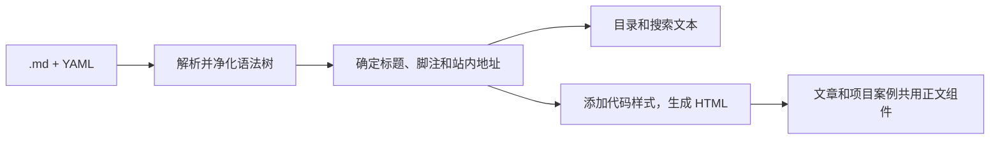

# 博客 Markdown 渲染调研

这是迁移前的调研记录；旧代码路径对应提交 `43fe480`，新实现和验证见[验收记录](../../.scratch/shiki-markdown-migration/acceptance.md)。

建议保留构建时的 `remark` / `rehype` 链路，让正文、目录和搜索文本共享同一棵语法树。先修复脚注、站内地址和代码块的显示问题，再评估用 Shiki 替换手写分行。保留 `.md` 和 YAML frontmatter 作为源文件，由内容目录验证并按稳定 `slug` 发布文章和项目案例。 [静态站约定](../adr/0001-keep-the-site-chinese-only-and-static.md) · [稳定 slug 约定](../adr/0003-use-explicit-stable-slugs.md) · [内容目录约定](../adr/0005-build-an-atomic-content-catalog.md) · [Next.js 静态导出](https://nextjs.org/docs/app/guides/static-exports#server-components)

## 当前链路与实际问题

`content-catalog.ts` 读取本地 `.md`，用 gray-matter 拆分 frontmatter，再用 Zod 验证。发布内容进入 `remark-gfm`，移除与 frontmatter 标题相同的首个 H1，经 `remark-rehype` 转成 HTML AST（HAST），再生成标题 ID、代码标记并净化。净化后的树提供 `html` 和 H1–H3 目录，文章还从树中提取 `/search-index.json` 使用的 `textBlocks`。两类详情页把 HTML 写入正文，复制按钮由客户端挂载。链路已经覆盖 CommonMark 和仓库约定的 GFM 能力，包括表格、任务列表、脚注、删除线和自动链接。 [内容目录](../../src/lib/content-catalog.ts) · 渲染器（`src/lib/markdown.ts`） · 文章模板（`src/components/post/post-detail-template.tsx`） · [项目详情](../../src/app/projects/%5Bslug%5D/page.tsx) · [搜索索引](../../src/app/search-index.json/route.ts) · [remark-gfm](https://github.com/remarkjs/remark-gfm#what-is-this)

7 个相关 Vitest 文件中的 66 项现有测试全部通过。`BASE_PATH=/blog` 的生产静态构建也通过。当前发布内容只有两篇文章和一个项目案例，正文没有围栏代码块或脚注，所以用临时 Markdown 样例检查了渲染结果，并在 Chrome 的已导出页面中临时插入代码块和表格标记，测量实际应用的 CSS。

| 位置           | 结果与影响                                                                                                                                                                                                                                                                                                                                                                                                                                                                                                                                                                                                          |
| -------------- | ------------------------------------------------------------------------------------------------------------------------------------------------------------------------------------------------------------------------------------------------------------------------------------------------------------------------------------------------------------------------------------------------------------------------------------------------------------------------------------------------------------------------------------------------------------------------------------------------------------------- |
| 脚注与目录     | 两处 `[^ref]` 引用同一个脚注时，正向和返回链接都找不到目标。转换器生成 `#user-content-fn-ref`，净化器再次给目标 ID 加前缀，变成 `user-content-user-content-fn-ref`。隐藏标题 `Footnotes` 还进入了可见目录。现有 `aria-describedby` 与脚注标签的 ID 匹配。 [脚注转换](https://github.com/syntax-tree/mdast-util-to-hast/blob/13.2.1/lib/handlers/footnote-reference.js#L19-L55) · [脚注尾注结构](https://github.com/syntax-tree/mdast-util-to-hast/blob/13.2.1/lib/footer.js) · [净化规则](https://github.com/syntax-tree/hast-util-sanitize/blob/5.0.2/lib/schema.js#L139-L146) · 目录提取（`src/lib/markdown.ts`） |
| 标题与部署路径 | `## 检查` 的实际 ID 是 `user-content-检查`，作者写的 `#检查` 无法到达。已有文章直接引用 `#user-content-使用前的检查清单`。以 `/blog` 为 `BASE_PATH` 时，Markdown 的 `/posts/2026-04-30/?q=词#…` 与 `/assets/example.png` 原样输出，浏览器会从域名根目录访问。项目封面已经用 `assetPath` 处理路径。 [现有文章](../../content/posts/zh-CN/26-04-30.md) · [路径工具](../../src/lib/site.ts) · [Next.js basePath](https://nextjs.org/docs/app/api-reference/config/next-config-js/basePath)                                                                                                                             |
| 代码分行       | `ts {2}` 中，第 1、2 行是同一个块注释、第 3 行是 `const result = 1;` 时，当前分行把整段注释放在第 1 行容器，把 `const` 放到标为高亮的第 2 行，第 3 行容器为空。`{2oops}` 也会被当成第 2 行。分行只切顶层文本，行范围在实际行数未知时就逐项展开，复制与搜索都读取处理后的代码文本。 [分行与元信息处理](../../src/lib/rehype-code-block.ts#L5-L37) · [复制按钮](../../src/components/post/code-block.tsx#L19-L61) · [搜索文本提取](../../src/lib/markdown.ts#L221-L274)                                                                                                                                               |
| 正文样式与交互 | 样式表缺少 `.hljs-*` 和 `[data-highlighted]` 的显示规则。Chrome 中代码正文与关键字同为 `#343733`，在 `#202326` 背景上对比度约 1.31∶1，高亮行和普通行的背景均透明。指定居中、靠右的表格单元格最终都靠左。复制按钮靠悬停显示，剪贴板拒绝时缺少反馈。 [正文 CSS](../../src/app/globals.css) · 复制按钮（`src/components/post/code-block.tsx`） · [WCAG 文字对比度](https://www.w3.org/WAI/WCAG22/Understanding/contrast-minimum.html) · [WCAG 键盘焦点可见](https://www.w3.org/WAI/WCAG22/Understanding/focus-visible.html)                                                                                            |
| 构建输入       | gray-matter 4.0.3 会读取 `---` 后的语言选择器，`---js` 和 `---javascript` 可进入使用 `eval` 的解析器。`matter()` 在 Zod 验证及草稿过滤之前调用。这是从安装版本源码确认的构建时行为。 [内容目录](../../src/lib/content-catalog.ts) · [gray-matter 语言选择](https://github.com/jonschlinkert/gray-matter/blob/master/index.js#L82-L109) · [解析引擎](https://github.com/jonschlinkert/gray-matter/blob/master/lib/engines.js#L33-L49)                                                                                                                                                                                |

## 方案比较

| 方案                                 | 对本博客的取舍                                                                                                                                                                                                                                                                                                                                                                                                                                                                                                                         |
| ------------------------------------ | -------------------------------------------------------------------------------------------------------------------------------------------------------------------------------------------------------------------------------------------------------------------------------------------------------------------------------------------------------------------------------------------------------------------------------------------------------------------------------------------------------------------------------------- |
| **现有 AST + Shiki**                 | 优先试点。`@shikijs/rehype` 在构建时输出带语法标记和逐行节点的 HAST，`transformerMetaHighlight` 支持已约定的 `{1,3-5}`。正文模板仍负责语言标签、复制和站点样式。Shiki 4.6.0 声明 Node.js ≥20，仓库使用 Node.js 24。实际语言覆盖、构建时间和 HTML 增量需要用本地试点测量。 [Shiki Rehype](https://shiki.style/packages/rehype) · [行高亮](https://shiki.style/packages/transformers#transformermetahighlight) · [Node 要求](https://github.com/shikijs/shiki/blob/v4.6.0/packages/rehype/package.json) · [仓库版本](../../package.json) |
| **现有 AST + `rehype-highlight`**    | 变动较小。补主题 CSS 和行样式，替换分行器或评估上游文档推荐的 `rehype-highlight-code-lines`。后者支持 `{1,3-5}`，需核对未标注代码块、首尾空行及超大行范围，仍需维护代码块外观和交互。 [主题 CSS](https://github.com/rehypejs/rehype-highlight#css) · [分行插件推荐](https://github.com/rehypejs/rehype-highlight#example-line-numbering-and-highlighting) · [分行插件源码](https://github.com/ipikuka/rehype-highlight-code-lines/blob/main/src/index.ts)                                                                              |
| **Expressive Code**                  | 同一 AST 链路里的成套代码块方案，自带代码主题、行标记、编辑器和终端框、复制按钮。适合确实需要这些代码展示功能时评估。接入前要核对样式和脚本在静态导出的加载、中文交互和复制原文。 [安装指南](https://expressive-code.com/installation/) · [代码框和复制](https://expressive-code.com/key-features/frames/) · [行标记](https://expressive-code.com/key-features/text-markers/)                                                                                                                                                          |
| **`react-markdown` / HAST 转 React** | `react-markdown` 可映射标签到组件，也有服务端 `MarkdownAsync`。本博客已在内容目录处理正文，直接把 Markdown 再交给组件会重复处理，或需要把目录及搜索提取移入组件内部的插件。若将来正文需要多个真正的 React 组件，可让现有安全 HAST 直接经 `hast-util-to-jsx-runtime` 输出，以便复用已提取的结构。 [react-markdown API](https://github.com/remarkjs/react-markdown#api) · [HAST 到 JSX](https://github.com/syntax-tree/hast-util-to-jsx-runtime#api)                                                                                     |
| **`@next/mdx`**                      | 适合作者明确需要在文档里写 JSX、导入组件或执行表达式的情况。App Router 需要 `mdx-components.tsx`，YAML frontmatter 仍需自行接入，Turbopack 下的插件配置有可序列化约束。内容目录的验证、稳定 URL、目录和搜索仍需设计。MDX 源码需按可执行代码信任。 [Next.js MDX](https://nextjs.org/docs/app/guides/mdx) · [Turbopack 插件](https://nextjs.org/docs/app/guides/mdx#using-plugins-with-turbopack) · [MDX 安全边界](https://mdxjs.com/docs/getting-started/#security)                                                                     |

## 实施与验收

1. **补齐输入、锚点和地址。** 解析 frontmatter 前限定 YAML，关闭可执行引擎。保留净化的 `id` 前缀保护及现有标题 ID。构建时按正文 H1–H6 的 slug 建立查找表；先查是否已经匹配最终 ID，再把 `#检查` 这样的写法解析成最终 ID。脚注引用、返回链接和 `aria-describedby` 一起绑定最终 ID，脚注 ID 与正文标题、脚注标签及页面已有 ID 去重。用 `remark-rehype` 的脚注标签和返回标签选项输出中文，生成的隐藏标题留给辅助技术，目录仅收正文 H1–H3。正文里约定的站内根路径应用 `BASE_PATH` 一次，保留查询参数、片段、绝对外链、协议相对 URL 和普通相对路径的原有含义。 [脚注本地化](https://github.com/remarkjs/remark-rehype#example-footnotes-in-languages-other-than-english) · [净化与标题 ID](https://github.com/rehypejs/rehype-sanitize#example-headings-dom-clobbering) · [Next.js basePath](https://nextjs.org/docs/app/api-reference/config/next-config-js/basePath)
2. **让语法树处理语义，让 CSS 和小组件处理阅读交互。** 用 `mdast`、`hast` 的类型替换手写 `any` 节点。保留现有的 URL 协议限制和原生 HTML 禁用规则。在同一棵树上确定最终标题 ID 并提取搜索文本，再加代码配色和标题自链接，避免链接图标、代码标题或复制提示进入目录与搜索。文章和项目案例共用正文组件，把已净化的 HTML 集中在一个入口。静态输出代码块结构，客户端只负责响应复制和播报结果。让触屏和键盘能发现复制按钮，为宽表提供局部滚动并保留列对齐，为代码正文和高亮行提供可读的颜色。 [语法树遍历](https://github.com/syntax-tree/unist-util-visit) · [标题自链接](https://github.com/rehypejs/rehype-autolink-headings) · [净化与高亮](https://github.com/rehypejs/rehype-sanitize#example-syntax-highlighting) · [Clipboard API](https://www.w3.org/TR/clipboard-apis/#dom-clipboard-writetext)
3. **用一份 Markdown 样例试 Shiki。** 复用 highlighter，加载常用语言和一个匹配站点的主题。用纯文本回退处理未知或未指定语言，复制以代码原文为准。验证 `mdast-util-to-hast` 自带的 `code.data.meta` 能穿过现有净化器，并在传给 transformer 前严格检查整数、按真实行数裁剪范围。Shiki 的官方 transformer 也会展开范围，不能直接接收任意上界。主题样式由受控主题生成，可在净化后运行受信任的高亮插件，避免为 Markdown 作者放开任意 `style`。若要使用类名方案，`transformerStyleToClass` 需要同时产出和加载 CSS。 [代码元信息](https://github.com/syntax-tree/mdast-util-to-hast/blob/13.2.1/lib/handlers/code.js) · [净化后保留节点数据](https://github.com/syntax-tree/hast-util-sanitize/blob/5.0.2/lib/index.js#L725-L734) · [Shiki 读取元信息](https://github.com/shikijs/shiki/blob/v4.6.0/packages/rehype/src/handlers.ts#L34-L59) · [行范围解析](https://github.com/shikijs/shiki/blob/v4.6.0/packages/transformers/src/transformers/meta-highlight.ts#L4-L20) · [Shiki 性能建议](https://shiki.style/guide/best-performance#cache-the-highlighter-instance) · [样式转类名](https://shiki.style/packages/transformers#transformerstyletoclass)
4. **验证导出的页面。** 用一份独立样例覆盖重复中文标题及现有深链接、重复脚注正反跳转和 ARIA 引用、危险 URL、非 YAML frontmatter、GFM 对齐宽表、嵌套列表、已知和未知语言代码。多行注释、空行、缩进、`{2oops}` 和超大范围用来校验高亮位置与复制原文。核对 `/` 和 `/blog` 两种构建下的静态 HTML、链接和图片，关闭 JavaScript 后正文与脚注仍可读、可跳转。在桌面和窄屏检查对比度、滚动和键盘复制。用同一份含实际代码块的内容比较两种高亮方案的构建时间和导出体积，确认 Shiki 能取代手写分行并通过上述检查后再切换。 [静态产物验收约定](../adr/0002-test-the-deployable-static-artifact.md) · 现有渲染测试（`src/lib/markdown.spec.ts`） · 复制测试（`src/components/post/code-block.spec.tsx`）

本次完成了现有实现的源码、渲染输出和上游文档核对。Shiki 集成与静态样例的浏览器验收待实施时验证。
