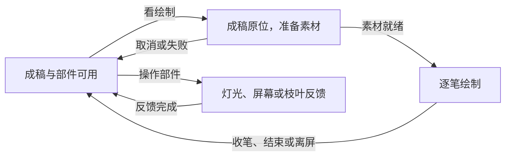

# 首页工作台重构调研

2026-11-18 · Hashflow · 基于 `c57ab05` 的逐笔绘制版、静态产物实测和一手资料。本文保留当时的点播方案和性能记录。当前工作台见[现行绘制和交互](../design/workbench-interaction-design.md)。

**建议保留现有素描和逐笔分镜，让成稿随静态首页展示。访客可以直接操作工作灯、电脑和盆栽，也可以点「看绘制」进入 6.6 秒作画。** 优先把作画、成稿和部件的就绪条件拆开，再修收笔时的整图跳变。这个建议以作品集访客能尽快看清首页、工作台可主动探索为前提。全站首屏的版式与内容方案见[首页优化设计](../design/homepage-redesign-2026-11-18.md)，原有走笔顺序见[手绘分镜](workbench-build-drawing-2026-11-17.md)。

## 原逐笔绘制版实测

| 场景                      | 观察                                                                                                                                                                                  | 截图                                                                                                                                                                                                        |
| ------------------------- | ------------------------------------------------------------------------------------------------------------------------------------------------------------------------------------- | ----------------------------------------------------------------------------------------------------------------------------------------------------------------------------------------------------------- |
| 1. 打开首页               | 静态 HTML 只有两处定位标记。关闭 JavaScript 时，「查看代表项目」仍可用，工作台停留在待绘制纸面。                                                                                      | [无脚本首屏](../../qa-evidence/workbench-refactor-2026-11-18/05-desktop-no-js.png)                                                                                                                          |
| 2. 看工作台形成           | 成稿和纸稿就绪后，在视口内自动起笔。铅笔跟着笔触勾出台脚、台沿和设备，纸纹与原画细节逐步补入。约 6.6 秒收笔，随后才有部件控件。                                                       | [桌面线稿阶段](../../qa-evidence/workbench-refactor-2026-11-18/01-desktop-drawing.png) · [桌面成稿](../../qa-evidence/workbench-refactor-2026-11-18/02-desktop-complete.png)                                |
| 3. 操作部件               | 聚焦灯后按空格可以关闭，焦点留在灯上。画上有七个透明热点，鼠标移到热区时才见手形指针。显示器与外接键盘共用一次出图动作。                                                              | [聚焦并关灯](../../qa-evidence/workbench-refactor-2026-11-18/03-desktop-lamp-off.png)                                                                                                                       |
| 4. 手机点按与滚动         | 390 px 视口下，灯罩热区约 84.1 × 12.1 CSS px，外接键盘约 42.5 × 6.6 CSS px，两对叶片热区相交。从键盘起手可以纵向滚动且未触发出图，直接点按同一位置能启动出图。                        | [手机成稿](../../qa-evidence/workbench-refactor-2026-11-18/04-mobile-complete.png)                                                                                                                          |
| 5. 减少动态效果与素材失败 | WebKit 模拟减少动态效果时直接显示成稿，灯可点按，纸稿与铅笔零请求。单独阻断叶片贴图时成稿仍可见，七个控件全部消失。源码对五张部件贴图做一次 `Promise.all`，任意失败都会锁住所有部件。 | [减少动态效果后关灯](../../qa-evidence/workbench-refactor-2026-11-18/06-webkit-mobile-reduced-lamp-off.png) · [叶片素材失败](../../qa-evidence/workbench-refactor-2026-11-18/07-webkit-missing-foliage.png) |

**等待主要来自加载门槛和固定播放时长。** 普通动效下首页预加载成稿 1,075,006 B、纸稿 776,538 B、铅笔 17,008 B，三个文件合计 1,868,552 B。五张部件贴图另计 23,326 B。390 × 844、DPR 2 的 Chrome 模拟使用冷缓存，节流设置为下行 1.6 Mbps、上行 0.75 Mbps、延迟 150 ms、CPU 4 倍减速。三次从导航到起笔的中位数为 **14.02 秒**，到成稿状态和灯按钮出现为 **20.63 秒**，同机无限速的一次移动端对照约 **6.72 秒**。节流样本中 LCP 最后候选是约 14.04 秒时的 SVG 图像，需另外记录成稿真正可见和各控件可用的时间。[计时与请求原始记录](../../qa-evidence/workbench-refactor-2026-11-18/observations.json) · [加载和播放源码](https://github.com/HashFlowSY/blog/blob/c57ab05f6eaa4ce5ee6e0a5090bfba1a26437660/src/components/home/assembly-workbench.tsx#L114) · [LCP 测量](https://web.dev/articles/optimize-lcp)

**作画的跳变出现在接通整图的那一帧。** 用固定时钟在 6.440 秒和 6.460 秒截图，隐藏铅笔，在原视觉验收的 720 × 607 选区比较 RGB。跨过 6.450 秒整图切换点时，约 **27.6%** 的像素至少一个通道变化超过 16（0–255），凳脚周围和台面、挂板细节都有变化。6.460 秒到 6.600 秒同一指标为 0，仍有轻微像素差异。源码在 6.450 秒移除纸底、线稿和局部透明蒙版，并显示完整原图。现有测试从切换后开始比对收笔，建议补查切换前的一帧。[切换前](../../qa-evidence/workbench-refactor-2026-11-18/09-art-before-settle.png) · [切换后](../../qa-evidence/workbench-refactor-2026-11-18/10-art-after-settle.png) · [收笔后](../../qa-evidence/workbench-refactor-2026-11-18/11-art-complete.png) · [逐帧像素数据](../../qa-evidence/workbench-refactor-2026-11-18/frame-observations.json) · [绘制合成](https://github.com/HashFlowSY/blog/blob/c57ab05f6eaa4ce5ee6e0a5090bfba1a26437660/src/components/home/workbench-drawing.tsx#L130) · [现有收笔测试](https://github.com/HashFlowSY/blog/blob/c57ab05f6eaa4ce5ee6e0a5090bfba1a26437660/e2e/home.spec.ts#L471)

测试使用本机已有的 `/blog/` 静态导出、Chrome 158 和缓存中的 WebKit 26.4。导出早于 `27563d1` 的首页文案更新，工作台源码和素材在这段提交区间一致。时间是本地模拟对照，真实手机、生产访问、读屏实机和逐帧性能录制留待实施验收。截图、编码试样与原始记录保存在本机的 `qa-evidence/workbench-refactor-2026-11-18/`。[WebKit 检查记录](../../qa-evidence/workbench-refactor-2026-11-18/webkit-observations.json)

## 三种进场方式

| 方案                           | 初访体验与交互                                                                                       | 取舍                                                                                       |
| ------------------------------ | ---------------------------------------------------------------------------------------------------- | ------------------------------------------------------------------------------------------ |
| A · 自动绘制，加可见的跳过按钮 | 画纸就绪后播放完整分镜，随时跳到成稿，灯和电脑在成稿上操作。                                         | 开场叙事最完整。正常浏览仍要经过等待和播放，刷新与返回也要明确是否重播。                   |
| **B · 成稿先行，长版点播**     | 进页看到完整工作台，「看绘制」可重复播放，同一按钮可回到成稿。灯、两个设备和盆栽随各自素材就绪开放。 | 首屏和部件操作能独立于作画就绪。需要解决点播前后画面接缝，以及成稿上的入口如何被发现。     |
| C · 短开场，长版点播           | 初访直接看见主体，约 1–2 秒内给台沿补一笔或为抽屉添黄。全段仍用「看绘制」。                          | 保留进入时的手绘记忆点。需要制作短分镜、定义首访和返回规则，并覆盖两套播放和减少动态偏好。 |

建议选 B。现有长版作画与正文、链接并行且自动开始，超过五秒时 WCAG 2.2.2 对非必要动态内容要求有暂停、停止或隐藏机制。点播让开始时机可控，提供「回到成稿」则方便观看中退出。Serkan Uslu 在自己的互动作品集中把正文保留为 HTML，触屏普通手势仍用来滚动，并给减少动态效果提供稳定的画面。可借用的是页面内容与场景操作各自可用的安排。[WCAG 2.2.2](https://www.w3.org/WAI/WCAG22/Understanding/pause-stop-hide.html) · [Serkan Uslu 的实现记录](https://www.serkanuslu.com/en/projects/new-website-design#comfortable-reading-alongside-play)

## 构建作画

### 镜头与收笔

现有画笔从右桌脚起笔，沿台沿去挂板与搁板。中段把设备、凳子和挂具放到已有结构上，最后压深阴影、画屏幕图纸和添黄。保留约 6.6 秒的节奏和笔尖跟随。窄屏首先检查 1.25 秒时桌脚到搁板的路径可追踪，以及上部盆栽、下部凳脚仍有余量。铅笔抬起移动期间纸面保留已经画过的线。[现有时序](https://github.com/HashFlowSY/blog/blob/c57ab05f6eaa4ce5ee6e0a5090bfba1a26437660/src/components/home/pencil-plan.ts#L27) · [笔尖轨迹和抬笔](https://github.com/HashFlowSY/blog/blob/c57ab05f6eaa4ce5ee6e0a5090bfba1a26437660/src/components/home/pencil-route.ts#L88)

把 6.450 秒集中出现的差异分配回各自部位。挂板暗部和孔位跟着挂板收尾，凳子与柜体接地影跟在排线后，抽屉添黄后把柜面纹理补齐。可为仍有差异的纸面和部件边缘预留一段短的局部混合，等同一幅成稿覆盖且视觉已对齐再解除蒙版。验收时比较收笔前后 20–30 ms 以及抬笔到结束的画面，分别看木纹、屏幕边缘和脚边投影。[局部纹理表](https://github.com/HashFlowSY/blog/blob/c57ab05f6eaa4ce5ee6e0a5090bfba1a26437660/src/components/home/workbench-geometry.ts#L634) · [SVG 遮罩规范](https://www.w3.org/TR/css-masking-1/)

### 分镜数据与播放

- **一份毫秒时间。** 将 `elapsedMs` 直接传给绘制层，沿用每笔起止时间和缓动，让笔触揭示比例和笔尖采样共享同一个值。SVG `pathLength="1"` 可用于归一化虚线。采样使用 `getTotalLength()` 与 `getPointAtLength()` 的原稿坐标。单笔保持一个连续子路径，抬笔动作单独计时。当前自定义路径度量只识别部分 SVG 指令，后续引入设计工具导出时集中校验路径命令、笔画 ID、时段和素材坐标。浏览器路径长度按笔缓存，覆盖 WebKit 和 Chromium 的几何采样。[笔触显示](https://github.com/HashFlowSY/blog/blob/c57ab05f6eaa4ce5ee6e0a5090bfba1a26437660/src/components/home/workbench-drawing.tsx#L77) · [路径度量](https://github.com/HashFlowSY/blog/blob/c57ab05f6eaa4ce5ee6e0a5090bfba1a26437660/src/components/home/pencil-path.ts#L8) · [SVG 路径长度](https://www.w3.org/TR/SVG2/paths.html#PathLengthAttribute) · [SVGGeometryElement](https://www.w3.org/TR/SVG2/types.html#InterfaceSVGGeometryElement)
- **播放模块只负责一轮作画。** 接收共享取景与所选成稿资源，提供按时间取帧、结束和失败结果。画边操作的模块决定何时启动或取消。一次作画由一个 `requestAnimationFrame` 时钟更新。离屏、隐藏、路由卸载和减少动态偏好变化统一收尾，取消后忽略旧的导入或解码回调。内部按时间取帧也服务固定截图和静态分镜。[现有播放生命周期](https://github.com/HashFlowSY/blog/blob/c57ab05f6eaa4ce5ee6e0a5090bfba1a26437660/src/components/home/assembly-workbench.tsx#L177) · [HTML 动画帧](https://html.spec.whatwg.org/multipage/imagebitmap-and-animations.html#animation-frames)
- **先量帧，再缩小更新范围。** 当前进度经 React 状态驱动，`DrawingMarkShape` 已用 `memo`，笔尖和蒙版仍在每帧更新。如果性能录制发现主线程瓶颈，先让已完成的笔迹保持稳定，更新正在绘制和正在淡出的局部。灯光的透明度和叶片的旋转仍可由现有部件逻辑驱动，有实测收益时再把个别属性交给 CSS 过渡或 Web Animations。[画线源码](https://github.com/HashFlowSY/blog/blob/c57ab05f6eaa4ce5ee6e0a5090bfba1a26437660/src/components/home/workbench-drawing.tsx#L32) · [铅笔逐帧更新](https://github.com/HashFlowSY/blog/blob/c57ab05f6eaa4ce5ee6e0a5090bfba1a26437660/src/components/home/workbench-pencil.tsx#L25) · [Web Animations 时间控制](https://drafts.csswg.org/web-animations-1/#setting-the-current-time-of-an-animation)

## 展示和素材构建

**共用原稿坐标。** 原稿为 1440 × 900，当前全幅取景纵向为 `y=82–764`，手机再取 `x=570–1340`。桌面沿用通栏首屏时可先用现有全幅。采用右栏版式时，可从 `(540, 82, 900, 682)` 试排。每种版式用同一取景矩形裁成稿和纸稿，提供给 SVG `viewBox`，以及用于 HTML 热区的坐标投影。画上点 `(x, y)` 的相对位置为 `((x − left) / width, (y − top) / height)`。画框和各层按同一取景切换，窄屏保留盆栽顶部、桌脚与凳脚。旋转手机导致取景改变时可结束本轮绘制，统一换到新取景的成稿和控件。[原稿坐标](https://github.com/HashFlowSY/blog/blob/c57ab05f6eaa4ce5ee6e0a5090bfba1a26437660/src/components/home/workbench-art.ts#L16) · [现有窄屏裁切](https://github.com/HashFlowSY/blog/blob/c57ab05f6eaa4ce5ee6e0a5090bfba1a26437660/src/components/home/assembly-workbench.module.css#L61) · [SVG viewBox](https://www.w3.org/TR/SVG2/coords.html#ViewBoxAttribute)

### 用同一取景试跑 WebP

从原稿取 `(570, 82, 770, 682)`，保留 770 × 682 原生像素，使用仓库已有的 sharp 重新编码。误差指解码后与无损裁切逐通道比较的平均绝对差，满量程为 255。

| 770 × 682 手机成稿 |      文件大小 | 样片结果                                                                                                                                                            |
| ------------------ | ------------: | ------------------------------------------------------------------------------------------------------------------------------------------------------------------- |
| 无损               |     594,860 B | 裁切后 RGB 像素一致。[无损样片](../../qa-evidence/workbench-refactor-2026-11-18/mobile-crop-lossless.webp)                                                          |
| **Q90**            | **116,138 B** | 约为无损裁切的五分之一，误差 1.62。线条清楚，细纸纹略淡。建议优先试排以及检查叠层。[Q90 样片](../../qa-evidence/workbench-refactor-2026-11-18/mobile-crop-q90.webp) |
| Q82                |      78,026 B | 误差 2.24，纸纹比 Q90 更平，作为更紧的体积备选。[Q82 样片](../../qa-evidence/workbench-refactor-2026-11-18/mobile-crop-q82.webp)                                    |

同取景纸稿的 Q90 试样为 16,776 B。已有的项目用成稿 900 × 682、101,130 B，像素抽样最接近原稿的 `(540, 82)` 裁切，适合试排桌面右栏；手机试样对应的是另外一个裁切。推荐先让点播的局部纹理和整图交接复用当次实际展示的成稿变体，再检查灯罩边缘、屏幕四角和活动枝叶的背景补丁是否需要随同一取景重导。编码或取景改变后先确认新视觉样张。同一取景、同一成稿在正常收笔、跳过、开灯归位时仍应做逐像素回归。[编码原始数据](../../qa-evidence/workbench-refactor-2026-11-18/asset-observations.json) · [纸稿样片](../../qa-evidence/workbench-refactor-2026-11-18/mobile-paper-q90.webp) · [项目用成稿](../../public/assets/projects/personal-blog/workbench-finished.webp) · [当前像素基线](https://github.com/HashFlowSY/blog/blob/c57ab05f6eaa4ce5ee6e0a5090bfba1a26437660/e2e/visual-regression.spec.ts#L100)

### 加载路径

1. **静态画面。** 让 `<picture>` 和有替代文字的 `` 随首页 HTML 输出，按画框提供相应的 `srcset`、`sizes` 和占位比例。首屏图片优先级用实测 LCP 和所选宽度确定。衍生图提前生成，资源路径沿用 `assetPath`，对应 GitHub Pages 的根目录和 `/blog`。仓库的 Next.js 静态导出配置为 `images.unoptimized: true`，要提供实际的响应式图片文件。[图片选择规范](https://html.spec.whatwg.org/multipage/images.html#adaptive-images) · [项目导出配置](../../next.config.ts#L5) · [Next.js 静态导出](https://nextjs.org/docs/app/guides/static-exports)
2. **轻量部件。** 在静态成稿上挂载独立的交互层。工作灯、两个设备和盆栽按各自所需素材解码后开放，画框底图继续可见。四组素材总量小，可以在接近视口时发起请求，错误落到对应的控制项。部件可以各自重试。[现有素材分组](https://github.com/HashFlowSY/blog/blob/c57ab05f6eaa4ce5ee6e0a5090bfba1a26437660/src/components/home/workbench-art.ts#L66) · [HTML 图片解码](https://html.spec.whatwg.org/multipage/embedded-content.html#dom-img-decode)
3. **点播才拉长版作画。** 从轻量客户端入口动态导入绘制模块及其路径数据，并在点播后请求纸稿和铅笔。加载时成稿仍在原位。同一资源的多次触发可复用正在解码或已就绪的结果。Next.js 文档明确 Server Component 直接动态导入 Client Component 当前没有自动代码拆分。最终用 `out/` 的网络请求验证客户端拆分，尤其确认首屏的部件逻辑没有间接引入绘图模块。[Next.js 按需加载](https://nextjs.org/docs/app/guides/lazy-loading#importing-client-components) · [当前静态导入](https://github.com/HashFlowSY/blog/blob/c57ab05f6eaa4ce5ee6e0a5090bfba1a26437660/src/components/home/assembly-workbench.tsx#L1)

## 操作和状态交接

画内保留桌上的铅笔、灯、笔记本、显示器和整株盆栽等对应入口。画边放一组可扫读的按钮，从「看绘制」「工作灯」「笔记本绘图」「显示器绘图」「拨动盆栽」开始试排。桌面能从画中的物件发现操作，手机用图下按钮和可辨认的大热区。画内触发与原生按钮调用同一动作，键盘每项只走一个有名称的 Tab 停靠点。灯的名称固定为「工作灯」，用 `aria-pressed` 表示开关。显示器和外接键盘共用一个操作，三片独立叶子的悬停摆动可作为细节保留。触屏的主要按钮以 **44 × 44 CSS px** 为易点目标，WCAG 2.5.8 的 AA 基准为 24 × 24 CSS px，另有间距和等效目标等例外。[WAI 按钮模式](https://www.w3.org/WAI/ARIA/apg/patterns/button/) · [WCAG 2.5.8](https://www.w3.org/WAI/WCAG22/Understanding/target-size-minimum.html) · [WCAG 2.5.5](https://www.w3.org/WAI/WCAG22/Understanding/target-size-enhanced.html)

| 操作                     | 建议反馈                                                                                                                                                                       |
| ------------------------ | ------------------------------------------------------------------------------------------------------------------------------------------------------------------------------ |
| 打开、刷新或用浏览器返回 | 显示完整成稿。新进入默认开灯，同一页从浏览器缓存恢复时可以恢复已选灯光。刷新和返回无需重新作画。                                                                               |
| 点「看绘制」             | 原位显示准备状态，同一按钮可「取消绘制」。纸稿与必要绘制代码就绪后从第一笔开始，按钮变为「回到成稿」。结束后焦点留在原按钮。                                                   |
| 播放中退出               | 键盘焦点在工作台内时，Esc 可收笔。播放中选部件时先回成稿、再执行所选动作。滚出画面、切后台或离开页面时结束本轮作画，返回时成稿可用。                                           |
| 开关工作灯               | 延续已经选定的柔和效果。灯罩位置固定，挂板与台面同步渐变，开约 220 ms，关约 170 ms，快速反向切换接续当前亮度。播前的灯光状态在收笔后恢复。                                     |
| 操作电脑                 | 点笔记本或显示器有立即可见的反馈。现版九次键位约 1.84 秒，之后出图约 2.75 秒。可对照现版和缩短打字的样片。建议同设备连点保持当前进度，切换到另一设备时结束上一段并启动新动作。 |
| 操作盆栽                 | 点按整株触发轻摆。支持悬停的输入继续让局部叶片沿固定枝干转动，手机上的竖向滚动与双指缩放保持正常。                                                                             |
| 减少动态效果             | 工作灯即时切换，设备直接给出清楚的静态图纸反馈。作画入口可显示起稿、线稿、成稿三个静态画面，盆栽静置。播放中切换偏好时结束位移动画并回到成稿。                                 |
| 素材失败                 | 成稿失败时给出替代文字。纸稿失败留在成稿并允许重试，铅笔单独失败仍可显示笔触。某个部件失败时该控件提示状态，其他部件继续操作。                                                 |

原生按钮用点击与键盘激活。画内点按在释放时确认，滑动、多点手势和 `pointercancel` 取消触发。焦点环在纸色和线稿上都要清楚。加载、失败和操作完成可用 `role="status"` 反馈，播报按用户动作和状态改变更新。部署验证覆盖从灯或设备起手滚动、画中与画边的同动作只触发一次，以及触屏和鼠标同机使用。[现有输入判定](https://github.com/HashFlowSY/blog/blob/c57ab05f6eaa4ce5ee6e0a5090bfba1a26437660/src/components/home/workbench-interactive.tsx#L90) · [现有灯、屏幕和叶片逻辑](https://github.com/HashFlowSY/blog/blob/c57ab05f6eaa4ce5ee6e0a5090bfba1a26437660/src/components/home/workbench-interactions.ts#L96) · [Pointer Events](https://www.w3.org/TR/pointerevents3/#the-touch-action-css-property) · [减少动态效果媒体查询](https://www.w3.org/TR/mediaqueries-5/#prefers-reduced-motion)

## 渲染技术取舍

| 路线                                          | 成本和适用条件                                                                                                                                                                                                   |
| --------------------------------------------- | ---------------------------------------------------------------------------------------------------------------------------------------------------------------------------------------------------------------- |
| **图片成稿 + SVG 笔触与局部叠层 + HTML 控件** | 复用原画、轨迹、合成裁切和部件行为。首轮成本集中在资源拆分、画框对位、收笔和输入。可固定时间截图，结合现有端到端检查。                                                                                           |
| 成稿 + 预渲染视频                             | 若作画只承担固定演示，视频能交付确定的节奏和光影。需输出适合手机和桌面的镜头，另处理停止、静帧和与原稿的色差。灯及屏幕仍由独立控件和图层处理。                                                                   |
| 成稿 + Canvas 2D 播放                         | 适合逐像素绘制、大量对象或实测 SVG 绘制和合成持续超预算的场景。需要重做各 DPR 的背板、确定性取帧、叠放和坐标映射，同时提供等效 HTML 操作。                                                                       |
| 成稿 + Rive                                   | 若设计人员需要在编辑器中长期独立调整交互状态机，可以试作一段。引入 Rive 资源和 Web 运行时，先用原画验证贴图接缝、键盘和触屏、按毫秒定位、离屏清理和部署子路径。高层 `scrub()` 已弃用，精确取帧应先核对可用接口。 |

当前已观察到的等待来自资源与播放条件，收笔跳变来自图层交接。用现有 SVG 处理两项问题所需的迁移最少。Canvas 或 Rive 的首轮样片只有在帧录制发现明确瓶颈，或素材维护者需要独立编辑状态机时才有足够的比较价值。[Canvas 规范](https://html.spec.whatwg.org/multipage/canvas.html#the-canvas-element) · [Rive 播放接口](https://rive.app/docs/runtimes/web/rive-parameters#scrub) · [Rive 低层接口](https://rive.app/docs/runtimes/web/low-level-api-usage)

## 实施顺序和验收

| 顺序            | 实现与检查                                                                                                                                                                                                                                  |
| --------------- | ------------------------------------------------------------------------------------------------------------------------------------------------------------------------------------------------------------------------------------------- |
| 1. 静态首画面   | 同一份原稿裁出桌面、手机成稿，接入实际首页。检查 320、390、760 断点两侧以及 1280、1440 CSS px 的画幅、页面放大和 DPR 1–3。关闭 JavaScript 仍可见完整工作台与首页链接。材料先比纸纹、黄色抽屉、灯罩和屏幕补丁。                              |
| 2. 轻量部件操作 | 先接工作灯和设备，再接整株盆栽。主要按钮的触控尺寸和间距按实测检查。用 Tab、Enter、空格、Esc、竖向滑动和快速重复操作验证，并在真机用 VoiceOver 检查控件名称与状态。模拟只丢一组素材，其他部件仍可以使用。                                   |
| 3. 点播与收笔   | 点播才发起纸稿、铅笔和绘制模块请求。检查准备时取消、路由切换、历史恢复、切后台、离屏和动效偏好变化。用固定时钟截取 `0.16 / 1.25 / 2.65 / 3.85 / 5.35 / 6.44 / 6.46 / 6.60 s`，比较笔尖与末端，并检查最后一轮纹理和画幅交接。                |
| 4. 对照发布产物 | 用相同视口、冷缓存和节流各跑三次，记成稿可见、灯可操作、点播反馈、首笔、工作台资源字节数和 LCP。若首轮采用 Q90，手机首屏工作台图片可先以 150 kB 为实验预算（成稿约 116 kB，五张部件贴图约 23 kB），实际性能目标结合生产产物和真机复测确定。 |

用现有的笔尖验证、灯光归位与触控滚动测试覆盖重构后的场景。将自动播放、刷新重播和固定七热点的断言更新为成稿直出、点播及各操作可达。实现稳定后按仓库的 `post-iteration-cleanup` 流程检查退役代码和说明。最终用 Chromium、WebKit 检查根路径和 `/blog` 的静态产物，覆盖无障碍、交互与视觉。保留当前固定参考图，用验收确认后的取景和编码生成相应视觉基线。[静态产物验证](../static-verification.md) · [现有工作台端到端测试](https://github.com/HashFlowSY/blog/blob/c57ab05f6eaa4ce5ee6e0a5090bfba1a26437660/e2e/home.spec.ts) · [WebKit 检查](https://github.com/HashFlowSY/blog/blob/c57ab05f6eaa4ce5ee6e0a5090bfba1a26437660/e2e/webkit-smoke.spec.ts) · [Playwright 固定时钟](https://playwright.dev/docs/clock)
